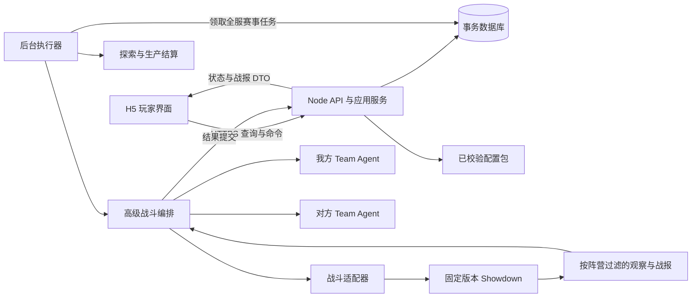

# 宝可梦 AFK 前后端与战斗框架设计

日期：2026-11-14。状态：实施基线；已接入真实战斗、账号经济、请求式挂机与道馆闭环。实际 AI 尚未接入。第16节记录当前联调实现与设计差异，启动见 [项目说明](../README.md)。

依据：[玩法设计](game-design.md)、[数据账本](game-data.md)、[模块素材/UI/存档方案](module-assets-ui-schema.md)、[道具与树果核查](item-berry-coverage.md)，以及本轮对配置拆分、携带物、特性、天气和场地效果的讨论。

## 1 已确认方向与本稿建议

已确认：H5 前端、持续运行的后端、前后端分离；后端优先 TypeScript / Node.js；以第九世代机制为候选，并保留规则版本切换能力。高级比赛每方六只全部参战、同时在场两只，采用最多 500 字的战斗风格。普通挂机不调用战术 AI。用户规模预计不超过 100 人。已进一步确认：实际等级、隐藏对方赛前名单、仅 Mega、NPC 多预设随机固定、道馆防守保存固定队伍与战术；跨季只重置道馆席位并刷新 NPC。

本稿建议：一个模块化后端、一个事务数据库、一个有并发上限的后台执行器。后台高级战斗在 Node 工作线程运行，避免阻塞 HTTP 请求；这是同一应用的执行隔离，不要求部署成多套微服务。当前本地联调采用 Node 24 内置 SQLite、Node HTTP 与原生 H5；后续有实际多进程需求再评估 PostgreSQL。

第九世代作为基础机制，并明确允许 Mega、禁用太晶化、极巨化和 Z 招式。它不等于采用官方 VGC 或社区分级赛制；首个闭环通过 Past 来源兼容旧物种与 Mega 道具，具体正式开放名单之后收敛。

本稿先规定模块、权威数据、交互边界和可验证路径。AI 的模型、提示词解析、搜索算法、调用频率与预算保持空白。

## 2 总体结构与职责



结果提交在后台调用同一应用服务的事务方法，不需要后台向自己发 HTTP。前端查询可轮询；如后续需要及时通知，再增加 SSE。浏览器是否打开不影响任务推进。

| 部分 | 负责 | 主要输出 |
| --- | --- | --- |
| H5 | 11 个玩家页面、表单、临时编辑、页面状态、战报播放、服务端时间的倒计时展示 | 玩家意图命令；不提交计算后的余额、胜负或孵化结果 |
| API 与应用服务 | 身份与归属检查、请求校验、版本冲突检查、操作编排、事务提交 | 允许该玩家看到的 DTO |
| 养成与经济模块 | 经验、EV、学习记录、手动进化、持物装备、设施、果园、繁殖、商店与交换 | 个体和资源的实际变化 |
| 探索结算 | 按时间推进遭遇、简单战斗、捕获、恢复、经验与掉落 | 可追溯的结算结果与下一状态 |
| 高级战斗编排 | 读取报名快照、组织两方决策、推进引擎、记录动作、结束与提交结果 | 战斗记录；不自行计算伤害 |
| 战斗适配器 | 本作 ID 与引擎 ID 转换、格式构建、合法性适配、协议转换、可见信息过滤 | 隔离上游类型后的本作协议 |
| Showdown | 当前规则版本内的招式、道具、特性、状态、天气、场地及回合执行 | 引擎状态、请求、协议事件和胜负 |
| Team Agent | 在允许的信息和选择范围内决定本方行动 | 一方完整的选择；没有经济与引擎状态写权限 |

H5 当前视觉 Demo 保留为视觉参考。未来功能 H5 使用服务端数据源；Demo 的固定数字、临时页签状态和商品样例不导入正式存档。

## 3 原版规则的接入方式

### 3.1 源码证据与适用限度

本地 Showdown 归档固定在提交 `7e743761cd13cdb361fc0f58eb5a866284894f5b`。本次直接读取了 `sim/SIMULATOR.md`、`sim/battle-stream.ts`、`sim/team-validator.ts`、`sim/battle.ts`、`sim/field.ts`、`sim/pokemon.ts`、`sim/side.ts`，以及 `data/items.ts`、`data/abilities.ts`、`data/conditions.ts`、`data/moves.ts`、`config/formats.ts`。

该归档已构建并接入本项目，真实战斗由它执行。本稿的源码核对不能替代运行测试。Showdown 是第三方模拟器，不是原作官方引擎；疑似偏差需要按指定游戏版本验证并记录。

上游提供输入选择、输出协议消息的模拟接口，并明确提醒传入队伍不会自动完成合法性验证。接入必须先校验队伍。[上游模拟接口](https://github.com/smogon/pokemon-showdown/blob/master/sim/SIMULATOR.md)

### 3.2 四个版本维度分别保存

| 维度 | 负责什么 | 切换要求 |
| --- | --- | --- |
| `mechanics_mod` | 第九世代等战斗机制 | 影响实际效果、取整、持续时间和交互 |
| `content_revision` | 本作允许的物种、形态、招式、特性、道具及学习表 | 能被引擎识别不代表可以开放 |
| `format_revision` | 六只全员双打、等级策略、公开范围、限制与自然超时 | 不自动套用 VGC 六选四或社区禁用表 |
| `engine_revision` + `adapter_revision` | 上游实现与本作适配版本 | 同一个世代标签也可能对应不同实现 |

另以 `config_revision` 固定挂机、经济、遗传和奖励参数。已经报名或开孵的任务保留旧版本引用；切换默认规则只影响之后创建的任务。

版本切换的验收含义是“选择一个已构建、已验证的完整规则包”，不是更改一个 `generation` 数字就宣称所有版本可用。跨版本不兼容的已学招式可以保留在收藏记录中，但在该赛制下不能装备上场；不静默删除培养成果。活动中的版本包不得被覆盖或提前删除。

效果绑定与检查目录必须从目标 mod 解析后的最终数据生成，包含其继承与覆盖；不能直接复制根 `data/` 的条目就当成某个历史世代的效果。上游归档中可存在本作未开放的特殊内容，仍需经过内容名单筛选。

### 3.3 本作规则采用显式扩展

先使用 `gen9` 对应机制，再构建本作双打格式。不能直接照搬 Doubles OU 的分级禁用，也不能使用放开队伍/招式/等级上限的 Custom Game 作为正式合法性规则。

自定义技能机遗传：保存亲代掌握证据、子代兼容性、规则版本及获得来源；对已证明合法的本作继承关系作范围有限的学习合法性扩展。不能为了通过一个遗传招式而关闭全部招式、特性、形态或数值校验。

等级养成、击败后捕获、繁殖时间、产业和果园属于本作规则。Showdown 的战斗模拟不能替代这些业务。

## 4 道具、特性与持续效果的共同设计

### 4.1 统一索引，保留实际作用域

| 效果种类 | 状态通常挂在哪 | 需要保留的差异 |
| --- | --- | --- |
| 携带道具 | 宝可梦 | 持有、消耗、失去、交换、压制，以及具体道具的例外 |
| 特性 | 宝可梦 | 原始与当前特性、复制/替换/压制、退场和失去能力的交互 |
| 非易失异常状态 | 宝可梦 | 睡眠、中毒、灼伤等；由引擎维护计数与互斥 |
| 临时状态 | 宝可梦 | 守住、替身、招式锁定等，各自有清除规则 |
| 天气 | 全场天气槽 | 天气类型、来源、有效状态、持续回合及替换规则 |
| Terrain 场地 | 全场场地槽 | 场地类型、来源、持续回合，以及每个对象是否受影响 |
| 阵营条件 | 一方阵营 | 顺风、墙、入场钉等，不随某一成员退场全部消失 |
| 位置条件 | 指定战斗位置 | 延迟生效或绑定位置的效果，不能只绑定个体 |
| 其他全场条件 | 全场条件集合 | 戏法空间等；可以与天气和 Terrain 共存 |

天气与 Terrain 不共用一个槽，顺风也不归入天气。所谓“光环”是效果描述，不意味着全部对象始终获得同一个属性加成。

### 4.2 对上一轮配置的补充

新增逻辑关系 `cfg_battle_effect_binding`，统一补齐携带物、特性和持续状态到实现的关联：

| 字段 | 类型 | 含义 |
| --- | --- | --- |
| `ruleset_key` | KEY | 所属规则包 |
| `effect_key` | KEY | 本作稳定效果标识 |
| `source_kind` | ENUM | item / ability / condition；招式本体仍走招式映射 |
| `source_key` | KEY | 资源键、特性 ID 的规范键或条件键 |
| `scope_kind` | ENUM | pokemon / side / slot / weather / terrain / field |
| `implementation_kind` | ENUM | upstream / approved_extension |
| `engine_effect_id` | TEXT? | 经过校验的引擎效果 ID |
| `extension_key` | KEY? | 自定义扩展注册名，二选一引用已安装实现 |
| `description_key` | KEY | 经核对的展示文案 |
| `enabled` | BOOL | 是否允许进入本作可运行内容 |

主键 `(ruleset_key, effect_key)`；同规则内来源映射需明确唯一性。使用这一关系统一现有 `engine_mapping` 的 item / ability / condition 部分，避免人工维护两个映射真源；其它实体映射继续保留。实际物理形式可在代码原型后合并为一份带类型的映射文件。

`catalog_resource` 和 `catalog_ability` 的公开目录增加 `battle_effect_key` 引用。需要单独展示的天气、Terrain、阵营条件生成 `catalog_battle_condition`，字段为 `effect_key`、`name_zh`、`scope_kind`、`description_key`、`icon_key`。

普通树果使用效果、携带后的战斗效果、果园种植参数是三个明确用途，通过同一个资源键关联。使用道具的 `cfg_item_use_effect` 不负责处理战斗中的自动吃果或触发消耗。

### 4.3 Trigger 目录从规则实现提取

可生成只读 `catalog_effect_hook` 用于检查：`ruleset_key`、`effect_key`、`hook_name`、`order`、`priority`、`sub_order`、`implementation_ref`。它描述已经存在的处理函数，不是另一套可编辑执行表。数字排序和特殊事件调度都由引擎负责。

例如本地版本中，道具触发可以同时涉及伤害修正、行动后效果和消耗判断；天气、Terrain、阵营条件各自有回合末顺序。`sim/battle.ts` 还有针对不同事件的特殊排序路径，不能用一个通用 priority 列完整重建。

某些重要行为并不位于效果对象的 hook 中，例如漂浮的接地判断、戏法空间的行动速度处理、灼伤的部分伤害处理。Hook 目录不代表完整机制覆盖；原版核心判定仍需复用并测试。

以下是在固定归档中核对到的代表性入口；它们说明一个效果可以参与多个事件，不是本作重新定义的调用顺序。

| 效果 | 代表入口 | 体现的职责 |
| --- | --- | --- |
| 吃剩的东西 | `onResidual` | 在原规则的回合末时机恢复 |
| 生命宝珠 | `onModifyDamage`、`onAfterMoveSecondarySelf` | 修正伤害及处理行动后的自身影响 |
| 威吓 | `onStart` | 入场/特性启动时处理对象及能力变化 |
| 雨天 | `onWeatherModifyDamage`、`onFieldResidual`、`onFieldEnd` | 影响伤害、持续处理与结束 |
| 电气场地 | `onBasePower`、`onSetStatus`、`onTryAddVolatile` | 检查接地与适用对象，再影响威力、状态或临时条件 |
| 顺风 | `onModifySpe`、`onSideEnd` | 作用于本方速度并按阵营条件生命周期结束 |

### 4.4 生命周期与修改原则

```text
来源成立 → 引擎判断能否获得/替换效果 → 建立对应作用域状态
事件发生 → 收集相关效果 → 判断压制/适用对象 → 按该事件规则调度
处理函数执行 → 引擎更新状态与后续事件 → 按规则持续、消耗或结束
```

这是职责示意，不是可以替换上游执行器的统一算法。不得在后端业务模块再跑一遍“所有效果每回合减 1”，否则持续时间与触发顺序会重复执行。

以下差异必须保留：

- 效果存在不代表当前生效；压制不等于删除。天气被压制时，天气本身及生命周期仍按原规则处理。
- 增益可在取属性、计算伤害或检查目标时即时生效，不必写入基础种族值或永久个体属性。
- 不把气势披带简化为永久“免死一次”，不把树果简化为全局一次性标记；具体触发、再获得与限制依原规则实现。
- 换人、失去战斗能力、持续时间结束、道具消耗是不同移除原因。
- 地面接触、例外特性、道具压制、替身、多段攻击和回合末顺序都参与交互，不由 UI 文案推导。

### 4.5 一个组合场景

示意场景：携带潮湿岩石的降雨特性成员入场，场上还有 Terrain，一方受到道具或天气压制效果影响。

1. 引擎按入场顺序处理特性，判断能否建立天气；设定来源与持续状态时查询该道具是否有效。
2. 天气与 Terrain 分别保留，不能互相覆盖；每次使用招式时分别检查适用对象与机制。
3. 伤害、命中、状态免疫等交互由当前版本的实际处理路径计算。
4. 某只成员达到树果触发条件时，由引擎检查能否吃果、是否被阻止，再执行消耗与效果。
5. 回合末继续使用引擎定义的顺序，输出实际事件；前端播放结果，不重算顺序。

需要验证具体组合，不能用“天气倍率 × 道具倍率 × 特性倍率”一条公式概括所有规则。

## 5 核心数据结构

以下 TypeScript 仅为协议草图，不是已生成代码或数据库迁移。短签名保持单行。所有 API 类型在实际接入时还需要运行时校验。

### 5.1 固定版本与参赛快照

```ts
type Key = string;
type SideId = "p1" | "p2";
type Stats6 = { hp: number; atk: number; def: number; spa: number; spd: number; spe: number };

interface BattleRuleRef {
  rulesetKey: Key;
  configRevision: string;
  contentRevision: string;
  formatRevision: string;
  mechanicsMod: string;
  engineRevision: string;
  adapterRevision: string;
}

interface BattleMemberSnapshot {
  memberKey: Key;
  sourceInstanceId?: string;
  pokemonId: number;
  formId?: number;
  level: number;
  gender: "M" | "F" | "N";
  natureId: number;
  abilityId: number;
  ivs: Stats6;
  evs: Stats6;
  friendship: number;
  moves: Array<{ moveId: number; ppUps: number }>;
  heldResourceKey: Key | null;
}

interface TeamSnapshot {
  snapshotId: string;
  owner: { kind: "player" | "npc"; id: string };
  rule: BattleRuleRef;
  members: BattleMemberSnapshot[];
  tacticText: string;
  createdAt: string;
  contentHash: string;
}
```

高级比赛校验成员数恰好 6、招式数不超过所选规则上限、500 字文本约束、来源归属、实际掌握招式和持物、EV/IV/特性/形态合法性。Mega 资格由形态、招式和持物等原规则检查；不接收太晶化、极巨化或 Z 招式输入。PP 强化当前是否开放仍待决定，字段表达的是原版战斗输入能力。

快照由服务器从真实个体与当前配置构造。前端只提交预设引用和预期版本，不能自己提交全满 IV 的快照。高级比赛的初始 HP、PP、异常与持物消耗隔离按格式政策初始化；日常战斗另传其实际日常状态。

### 5.2 战斗运行状态与展示状态

战斗完整状态只由引擎维护。适配器可以读出下面的调试投影，但不会把它作为第二套可写状态，也不为每个天气、特性和状态分别建 SQL 表。

```ts
type EffectScope =
  | { kind: "pokemon"; side: SideId; memberKey: Key }
  | { kind: "side"; side: SideId }
  | { kind: "slot"; side: SideId; slot: number }
  | { kind: "weather" | "terrain" | "field" };

interface RuntimeEffectProjection {
  runtimeId: string;
  effectKey: Key;
  scope: EffectScope;
  sourceMemberKey?: Key;
  sourceEffectKey?: Key;
  remainingTurns: number | null;
  layers?: number;
  activationState: "active" | "suppressed" | "ended";
}

type Known<T> = { kind: "known"; value: T } | { kind: "unknown" };

interface VisibleEffect {
  effectKey: Key;
  scope: EffectScope;
  remainingTurns: Known<number | null>;
  sourceMemberKey: Known<Key | null>;
}
```

`RuntimeEffectProjection` 只是检查时可读的快照，不能据此实现效果恢复或调度。上游私有状态格式由固定引擎版本管理；未来若需要持久恢复再验证原生序列化，不在首版先开发通用断点恢复。

对手道具、特性或持续时间未知时使用 `unknown`，与“已知没有道具”的 `known(null)` 分开。对手状态显示使用协议允许的表观物种、HP 精度和已揭示信息，不能直接从真实引擎对象复制；幻觉、未揭示持物及延长天气时长是重要检查例子。

### 5.3 运行记录的最小增量

复用原文 R01–R27。R18 为报名快照、R20 为比赛主记录；本轮细化其内容和必要明细，而非另造一套比赛系统。R20 原提案中的 `decision_observations_json` 由以下决策请求/提交尝试明细替代，`events_json` 由事件明细替代，两处旧字段不再存另一份完整内容。原 R20 的赛事、双方报名、轮次/场次、实验关联、初始状态及决策配置等字段继续保留，以下只列本轮关注部分。

| 记录 | 主要字段 | 写入者、用途与保留 |
| --- | --- | --- |
| `battle`（原 R20 主记录） | `id`、双方报名/快照引用、规则版本、种子、`status`、胜负与结束原因、开始/结束时间、`settled_at` | 编排器写状态，应用服务提交结果；保留比赛与论文证据 |
| `battle_decision`（R20 明细） | `battle_id`、`decision_seq`、`side`、`request_id`、阶段、观察摘要哈希、Agent 实现标识、`status`、`accepted_attempt_no`、时间 | 编排器写请求边界；唯一约束 `(battle_id, decision_seq, side)`；更新请求使用新序号；接受结果只引用对应尝试，不复制选择内容 |
| `battle_choice_attempt`（决策明细） | 上述决策组合键、`attempt_no`、`submitted_payload`、`normalized_engine_choice`、`validation_status`、`rejection_code`、`rejection_reason`、实际调用次数、决策/提供方耗时毫秒、输入/输出 token 数、时间 | 每次提交均追加，接受或拒绝均保留；唯一约束为决策键加尝试号，每个请求最多一条最终接受记录；供非法行动与实际调用统计 |
| `battle_event`（R20 明细） | `battle_id`、`event_seq`、回合、事件种类、行动者/目标、影响、可见范围、协议来源 | 适配器写；供战报读取，唯一约束 `(battle_id, event_seq)` |
| `scheduled_job` | `id`、`kind`、`target_id`、`due_at`、`status`、`claimed_at`、`finished_at` | 应用服务创建、单后台协调者领取；只支撑全服赛事开赛等全服任务；不为玩家孵化、果树或恢复分别建后台到期任务，保留到任务结束与必要排查完成 |
| `command_receipt` | `player_id`、`command_id`、请求哈希、结果摘要 | 与有资产副作用的命令同事务写入；去重双击和响应丢失后的重试，不承担完整事件溯源 |

研究需要保存实际动作序列；只有随机种子不能重现模型当时选择。日志包含结果和必要动作，不要求模型内部思考链。

`submitted_payload` 保存送入动作校验的方案，包括结构不合法或过期的提交；`normalized_engine_choice` 保存成功转换后的引擎命令。拒绝后即使直接停止该场，也必须保留本次尝试与原因。新尝试不覆盖旧记录；这不意味着已经启用自动重试。没有返回方案的技术异常单独记录，不计为非法动作。

非法行动比例以提交校验的完整本方方案为单位，从尝试明细计算；同一决策的多次尝试分别计数，正常战斗中因倒下等原因未执行的合法动作不计非法。没有样本时比例为空。调用量和耗时使用实测值，未提供的 token 用量为 null；固定策略没有模型调用可记录为 0。准备阶段的额外 AI 成本待其接口实际设计时补充，不能混入已测回合指标或从预算反推。

效果原始私有日志限服务端；公开战报与阵营战报按查看者分别生成。精确观察快照属于按需实验数据，不能默认对所有玩家公开或无限保存模型调用全文。

## 6 Team Agent 的职责和协议

### 6.1 一个阵营一个 Agent

高级双打的一方由一个 Team Agent 同时选择两只在场成员的动作，管理六只成员的配合。首版不采用每只宝可梦独立决策后再合并的方案，这会引入重复换入、目标冲突及有限资源重复使用问题。

两边分别获得自己的 Agent 会话，NPC 使用同样的可见信息边界。每场会话独立，不共享跨对局的对手秘密。Agent 是后端决策角色，暂不等同于某个多 Agent 框架或长期独立进程。

### 6.2 战术准备与回合选择分开

战术准备读取本方六只快照、战斗风格和公开规则，输出一个不透明、带版本的准备结果；目前不定义如何分析。回合选择读取当前允许观察、选择请求和自己的会话记忆，输出该阶段的完整决定。

```ts
interface TacticPreparationInput {
  rule: BattleRuleRef;
  ownTeam: TeamSnapshot;
  tacticText: string;
}

interface PreparedTactic {
  preparationRevision: string;
  tacticHash: string;
  payload: unknown;
}

interface TacticPreparer {
  prepare(input: TacticPreparationInput): Promise<PreparedTactic>;
}

type SlotChoice =
  | { kind: "move"; activeSlot: number; moveSlot: number; targetToken?: string; mechanicToken?: string }
  | { kind: "switch"; activeSlot: number; incomingMemberKey: Key }
  | { kind: "pass"; activeSlot: number };

type ChoicePayload =
  | { phase: "lead_selection"; orderedMemberKeys: Key[] }
  | { phase: "move"; choices: SlotChoice[] }
  | { phase: "forced_switch"; choices: SlotChoice[] };

interface TeamDecision {
  requestId: string;
  observationRevision: string;
  choice: ChoicePayload;
}

interface TeamAgent {
  decide(context: DecisionContext): Promise<TeamDecision>;
}
```

`DecisionContext` 的固定外壳如下：

| 字段 | 内容 |
| --- | --- |
| `battleId`、`side`、`decisionSeq` | 当前对局与决策身份 |
| `requestId`、`observationRevision` | 拒绝过期决策与重复提交 |
| `phase` | 首发选择、正常行动、强制替换；wait 不调用 Agent |
| `ownTeamView` | 本方有权知道的成员与当前状态 |
| `opponentView` | 对手已经公开的表观状态，未揭示字段明确 unknown |
| `fieldView` | 可见天气、Terrain、阵营及位置条件 |
| `visibleEvents` | 自上一决策以来该方可见事件 |
| `choiceRequest` | 从本方引擎请求转换的候选动作、目标和共同约束 |
| `preparedTactic` | 战术准备结果；AI 实现留空 |
| `sessionMemory` | 本场该方自行维护的观察与推断；不能注入对手私有状态 |

这些类型中的 `unknown` 只保留给尚未设计的 AI 产物，不作为经济配置和原版效果的任意脚本入口。

### 6.3 选择与最终合法性

`choiceRequest` 只来自该方请求和已公开信息。它不能通过查询对手隐藏特性或模拟对手本回合已选动作，提前筛掉某些候选。部分动作最终是否可执行，要由原版请求/校验/行动失败机制揭示；候选列表不承诺知道全部隐藏事实。

校验包括：阶段相符、成员与槽位正确、招式属于当前请求、目标合法、两只不能换入同一个替补、共用的一次性机制不能重复申请、pass 只用于明确允许的位置。适配器把完整本方决定转换为引擎选择，最终仍由引擎验证。

双打行动不能用简单的“各自合法动作笛卡尔积”代替联合校验，也不能由 Agent 返回伤害值、天气持续时间或道具消耗结果。

初期用固定策略的 `ScriptedTeamAgent` 验证接口。AI 策略未接入时明确标记，不能把固定策略当成“已分析玩家战术”。模型名称、推理算法、工具调用、成本预算、重试与降级策略均留空。

## 7 高级战斗流程

### 7.1 报名与冻结

1. API 验证身份、成员归属、配对/交换/参赛兼容约束，并推进需要结算的旧日常活动。
2. 校验本作获得来源与所选战斗版本合法性，校验持物真实存在。生成不可变快照与 500 字战术文本。
3. 同一事务写报名、成员限制和到期任务；异步执行不持有此事务等待模型。
4. 到期开赛读取玩家固定快照；NPC 对手在此时从候选预设中选择并冻结队伍和风格。之后不重新读取可编辑的日常编队。

### 7.2 首发与每次选择

```text
读双方快照 → 创建固定版本引擎 → 建立双方独立观察通道
    ↓
处理首发选择或读取引擎请求
    ↓
在同一个决策边界冻结双方允许的观察
    ↓
只向需要行动的一方或双方发送请求
    ↓
Agent 返回完整选择 → 校验并暂存
    ↓
本阶段所有必须选择均就绪 → 提交引擎 → 引擎执行到下一请求或结束
    ↓
记录实际动作与事件 → 下一阶段
```

双方同阶段需要行动时，不能让后返回的一方看到先返回方尚未公开的选择。只有一方需要强制替换时，不给另一方伪造一次普通行动；连环替换和中途换人跟随引擎请求，不强制每回合正好调用两次 Agent。

赛前不公开对方物种名单。首个闭环不启用会泄露完整名单的 Team Preview，使用本方配置的成员顺序作为首发；未来首发调整也只允许基于本方信息。六只都保留参赛资格，不变成六选四。

非法返回不推进战局；陈旧 requestId 不可重放。具体重试与降级尚未设计，首个验证原型可以停止该场并记录技术异常。AI/服务器故障不得伪装成玩家消极比赛。自然回合/赛程时限的平局或双败由已确定赛制处理，不能把模型网络超时当作同一概念。

### 7.3 结果提交

引擎结束 → 编排器产出战斗结果 → 应用服务在短事务中检查该场尚未结算、更新比赛与必要席位/赛程、建立奖励资格、写重要日志。唯一比赛 ID 和奖励来源键防止重复提交产生双份奖励。

道馆防守持有当时队伍和战术的独立存档，不能引用玩家之后可编辑的预设。保存防守快照不持续占用真实成员或主理人。挑战时绑定席位和该防守快照；提交结果做席位版本检查，避免并发结果覆盖。现已接入串行受理、后台比赛、接任与事务结算。

当前联调高级比赛采用快照隔离：持物消耗、交换或被拍落只改变比赛状态。根据用户最新确认，普通探索只持久化HP和真实资源消耗，PP/异常每场重置；重新装备通过库存扣发。HP是探索持续进度，不把PP不足作为挂机门槛；高级战斗内的PP、异常与原版规则保持独立。

## 8 持续挂机、生产与时间

玩家活动保存开始时间、完成时间或已结算游标，不建立逐玩家倒计时。H5 展示服务器给出的 `completeAt`，到期后申请结算；后端使用自己的当前时间验证，客户端不能用伪造时间提前领取。

请求、下次登录或相关配置变更可以触发补结算。玩家离线时不必真的在那个秒点执行回调：下次处理时按真实完成时刻与经过时间补算。全服赛事、NPC 刷新、赛季边界可以保留后台调度，这与玩家活动的请求结算分开。

```text
玩家开始活动 → 服务端确定完成时间/游标并保存
前端到期申请 / 下次登录 → 后端读取存档与服务器当前时间
尚未到期 → 拒绝提前结算
已到期 → 在事务中提交结果与完成状态
已结算 → 返回已有结果，不再次发奖
```

探索和产业属于持续过程，按已结算游标推进；恢复、资源耗尽、时间窗、升级和批次完成分段。一次领取与多次领取应等价，不能把领取时间当成稀有遭遇时间。实际资产与游标现由 GameService 在 SQLite 同一事务提交；`settleActivity` 保留为原有时间基础函数，实际模块入口见第16节。

长期挂机的批量模拟可以作为请求产生的后台工作，不要求 HTTP 请求同步跑完。普通实力接近或被压制的探索建议复用引擎配简单策略；快速近似器需要另外验证，不使用玩家战术 AI。

产业、孵化使用秒；战斗天气和招式持续效果使用引擎回合。现实时间经过一分钟不会自动扣减战斗中的天气回合。

## 9 H5 与 API 数据边界

建议 HTTP JSON 接口，客户端只共享 DTO、错误码和字段校验描述，不直接导入服务端数据库模型、规则实现或私有战斗类型。

| 操作 | 请求示例职责 | 返回内容 |
| --- | --- | --- |
| `GET /api/catalog` | 指定公开目录版本 | 已开放内容、名称、说明、素材与公开规则摘要 |
| `GET /api/dashboard` | 当前用户 | 服务器时间、活动摘要、告警、待领奖励、最近日志 |
| `PUT /api/team-presets/:id` | 成员引用、展示配置、战术、预期版本 | 已保存预设与合法性提示 |
| `POST /api/expeditions` | 地区、预设、心愿与授权携带资源 | 服务端接受的探索安排和活动版本 |
| `POST /api/hatch-batches/:id/start` | 主理人引用、预期批次版本 | 已冻结批次、完成时间；不泄露未揭示结果 |
| `POST /api/event-entries` | 赛事、预设、预期版本 | 报名状态和本方快照摘要 |
| `GET /api/battles/:id` | 由服务端确认查看权限 | 当前状态、允许查看的结果与条件展示 |
| `GET /api/battles/:id/events?after=...` | 可见事件游标 | 已过滤的增量战报，不能通过指定 side 越权 |
| `POST /api/shop-purchases` | 商品、数量、刷新批次、commandId | 实际成交结果和库存摘要 |
| `POST /api/trades/:id/accept` | 对方条件下的本方个体、版本、commandId | 原子完成后的交换结果 |

资金、持物、岗位、交换和奖励以服务端事务为准。同一个 commandId 的不同请求体应拒绝；同一请求重复发送返回原结果。资源不足或版本冲突返回明确错误，前端重新获取状态，不自行回滚或拼凑余额。

鉴权和记录级归属检查覆盖全部修改操作。最终登录方式仍待实现阶段选择；架构已经要求登录身份不能由请求体中的 playerId 冒充。

## 10 配置、代码与数据文件的先后顺序

先确认接口与规则样例，再做战斗适配原型，最后固化配置结构。特别是 effect binding、选择协议和规则扩展字段，要用真实引擎输入验证后定版。

```text
原始快照 + 本作配置草稿
  → 规范化、ID 映射、来源与版本校验
  → 引擎解析和队伍/样例校验
  → 不可变的完整配置包
  → 后端加载私有内容 / H5 读取公开投影
```

角色队伍、战术、奖励概率及未公开的配置不因“在配置文件里”就全部打包给 H5。HTTP 返回的公开目录不包含 NPC 完整队伍和隐藏状态。

导入至少检查：孤立引用、物种/数据形态/外观形态错配、未映射效果、版本不支持的内容、非法队伍、概率/权重混用、条件空值、学习表与本作继承扩展冲突。已确认的洛玫果重复来源 ID 保留显式整理记录，不用同名自动覆盖。

## 11 目录与实现边界建议

以下只是未来责任分布，不创建空目录、不逐模块生成服务和 Repository。

| 建议路径 | 责任与单独存在的原因 |
| --- | --- |
| `apps/web/` | 功能 H5 与展示状态，沿用已确认视觉 |
| `apps/server/` | HTTP 入口、应用服务、各业务模块、后台协调者、存储访问 |
| `packages/contracts/` | 经过筛选的前后端公开 DTO 和校验约定 |
| `packages/battle-adapter/` | 上游映射、自定义格式、合法性扩展、观察与选择转换；限制版本变化影响 |
| `apps/server/battle/agents/` | Team Agent 接口、测试用固定策略、未来 AI 实现位置 |
| `config/` | 本作维护配置，批准结构后再创建 |
| `data/`、`assets/` | 继续使用现有来源快照与素材 |

当前代码采用 `src/battle/`、`src/game/`、`web/game/` 和 `web/battle-lab/`，没有预先拆成上述所有包。已建立 SQLite 账号/经济存储并保留原视觉 Demo。第5节是后续拆分存储的领域设计，第16节说明现有紧凑实现；效果投影仍只作为读取结构。

## 12 首个可运行闭环与验收

先实现一场固定队伍的六只双打：规则包 → 双方合法快照 → 两个固定策略 Agent → 战斗适配器 → 真实结果 → 按权限展示战报。这个闭环通过后再固定相关配置格式，并接入报名、奖励与挂机模块。

| 验证项 | 应证明的性质 |
| --- | --- |
| 原版差分 | 同规则、种子和接受的动作序列，与固定上游引擎的事件和结果一致；本作扩展单列预期差异 |
| 道具 | 吃剩的东西、生命宝珠、气势披带、树果、拘束类与道具压制/失去的代表性交互 |
| 特性 | 入场效果、接地/免疫、压制和替换；不只测面板加成 |
| 场地与天气 | 共存、替换、来源延长、压制、接地条件和结束顺序；参数来自目标版本 |
| 双打 | 群体招式、队友目标、联合换人、强制替换、行动顺序；六只都能投入 |
| 公开信息 | 两个世界仅在对手尚未揭示资料上不同，合法可见观察与候选请求不因此提前不同；遵循原版实际揭示事件 |
| 学习合法性 | 原版允许、原版禁止、本作已证明的技能机继承扩展分别处理 |
| 日常经济 | 双击购买、重复领取、重复结果提交不重复扣发；持物有且仅有一个实际归属 |
| 时间 | 同段挂机一次结算与分次结算等价；午夜窗口、20 分钟候选恢复、跨季边界各自分段 |
| 前后端分离 | 关闭 H5 后任务仍推进；重开获取权威结果；客户端篡改时间与展示数值不增加资产 |

不要求为纯视觉重新编写规则测试。上述测试应随实际适配代码建立，当前文档没有声称它们已经通过。

## 13 待确认项与 AI 留白

基础版本已经缩小到第九世代候选，技术方向已经缩小到 TypeScript / Node.js；以下仍需在对应实现前确认：

- 第九世代具体数据口径、正式开放名单、跨作机制更新方式，以及物种/道具重复限制；Mega 已启用，其它特殊机制已禁用。
- 已确认不公开赛前名单、使用实际等级；未来自主调整首发只读取本方信息。
- 高级比赛持物是否按建议完全隔离日常库存；普通探索中消耗、偷取、丢失与重新装备如何结算。
- 道馆防守快照独立于日常岗位；跨季只替换道馆席位。完整联赛赛制与并发挑战受理流程仍待对应模块实施。
- 之前数据文档中仍待定的数值、初始伙伴和经济参数。

AI 留白：`TacticPreparer` 的产物格式、模型、提示词组织、策略分析与搜索、记忆压缩、调用频率与预算、异常重试/降级。已经设计的是它的输入输出与权限约束，不代表任何 AI 技术方案已经选定。

## 14 来源与核对入口

固定源码来自 [Showdown 版本记录](../data/sources/showdown-revision.json) 和记录中的本地归档；下列链接用于定位同版本代码。本稿对机制的具体观察以本地固定版本为准，后续更新需重新验证。

- [道具实现](https://github.com/smogon/pokemon-showdown/blob/7e743761cd13cdb361fc0f58eb5a866284894f5b/data/items.ts)：携带物触发、修正与消耗。
- [特性实现](https://github.com/smogon/pokemon-showdown/blob/7e743761cd13cdb361fc0f58eb5a866284894f5b/data/abilities.ts)：入场及持续机制。
- [条件实现](https://github.com/smogon/pokemon-showdown/blob/7e743761cd13cdb361fc0f58eb5a866284894f5b/data/conditions.ts)与[招式内附条件](https://github.com/smogon/pokemon-showdown/blob/7e743761cd13cdb361fc0f58eb5a866284894f5b/data/moves.ts)：天气、状态、Terrain、空间、阵营条件。
- [调度实现](https://github.com/smogon/pokemon-showdown/blob/7e743761cd13cdb361fc0f58eb5a866284894f5b/sim/battle.ts)、[场地状态](https://github.com/smogon/pokemon-showdown/blob/7e743761cd13cdb361fc0f58eb5a866284894f5b/sim/field.ts)、[个体状态](https://github.com/smogon/pokemon-showdown/blob/7e743761cd13cdb361fc0f58eb5a866284894f5b/sim/pokemon.ts)。
- [阵营流分离](https://github.com/smogon/pokemon-showdown/blob/7e743761cd13cdb361fc0f58eb5a866284894f5b/sim/battle-stream.ts)、[选择协议](https://github.com/smogon/pokemon-showdown/blob/7e743761cd13cdb361fc0f58eb5a866284894f5b/sim/SIM-PROTOCOL.md)、[队伍验证](https://github.com/smogon/pokemon-showdown/blob/7e743761cd13cdb361fc0f58eb5a866284894f5b/sim/team-validator.ts)。

本轮还在线核对了上游模拟接口与 Node 接口说明。未稳定承诺的 API 尤其需要固定版本，见 [Node 接口说明](https://github.com/smogon/pokemon-showdown/blob/master/sim/README.md)。

## 15 首个闭环实施记录

已实现 `src/battle`、`src/domain`、`src/server.ts` 与 `web/battle-lab`。道具、特性和条件由 EffectDefinition 共同父类反序列化，具体类型由 kind 区分；`config/effect-catalog.json` 保存目标 mod 解析后的技术索引，`battle-effects.json` 保存本作覆盖。当前导出 1,066 条技术效果定义，不表示全部已经开放。

可执行 JSON 形态为 `{kind, engineId, handler?, parameters?}`。handler 只能引用注册实现，parameters 经过对应结构校验；当前验证了回血比例和攻击倍率两类参数，其余完整原版机制继承上游。官方更新若改变已支持参数，可修改 JSON 发布新 revision；若增加事件、判定或交互，仍需增加处理器或更新引擎。无形拳在不同游戏版本的差异不自动混入 gen9。

发布记录保存完整规则包和指纹。同一 revision 不允许不同内容；worker 核对实际加载配置和 NPC 预设与服务端启动版本一致，不一致则记录技术失败，不能用新配置悄悄执行旧任务。修改配置发布新版本后需重启，不承诺活动战斗中途热替换。

首个运行版本使用两方固定策略，保存真实协议事件、选择及私有初始快照；没有战术 AI。原 HTTP 实验入口仍只接受固定队伍。账号道馆接口从服务端实际成员建立双方快照，分别输出 p1/p2 通道的战报，不接受浏览器提交的胜负、NPC 选择或数值。

玩家计时、完整挂机收益和道馆挑战已接入；全服自动赛程仍未实现。联调初始伙伴和经济参数独立放在 `gameplay.test.json`，不覆盖正式数据账本的待定项。原版数值优先使用所选机制实现。

## 16 账号、挂机与道馆联调实现

本轮入口：`src/game/routes.ts` → `GameService` → `GameStore`；H5 位于 `web/game/`。数据库为 `.runtime/battles/game.sqlite`，WAL 模式。数据库内保存账号、会话、玩家 JSON、世界席位、命令回执、资源账本和账号比赛；不额外建立逐玩家后台任务。

| 记录 | 当前关键结构 | 写入与读取 |
| --- | --- | --- |
| accounts / sessions | 密码的盐与哈希；会话令牌哈希、真实时间到期 | 注册/登录/退出；每个账号接口检查 |
| players.state | 伙伴实例、库存、队伍、500字战术、心愿单、探索游标、设施岗位/余数、果园缓存、育成批次、荣誉和日志 | 操作和补结算同事务保存，状态查询返回过滤后的本人内容 |
| world.state | season、8个席位、ownerId、version、activeBattleId、不可变 defense | 报名锁定席位；完成结果检查赛季与席位版本；切季仅替换席位 |
| receipts | player_id + commandId、请求指纹、原响应 | 重试返回原结果；相同编号不能换请求，防止重复扣发 |
| ledger | player_id、时间、原因、资源净变化 | 与资源变更同事务；H5 展示最近30笔 |
| gym_battles.state | challenger/defender、季/席位版本、双方快照、状态、真实结果 | 双方只能看本方事件；私有队伍/战术不由 API 输出 |

状态中的核心时间字段为 `exploration.cursor/recoveryUntil`、`facility.cursor/remainder`、`plot.plantedAt/cursor/buffer`、`nursery.completeAt` 与 `centerUntil`。服务器统一读取 `GameClock` 提供的个人游戏时间推进（见第18节）；前端只展示倒计时并发起查询。探索每次请求最多推进120次遭遇，未完成时返回 catchingUp，由 H5 连续申请；游标、随机状态和资源同时提交。普通战斗目前在请求内有界执行，高级战斗复用两个工作线程的并发上限。

恢复耗时采用 `ceil(recoverySeconds × 队伍总缺失HP / 队伍总HP)` 秒，其中 recoverySeconds 当前为1200秒上限。满血直接返回且不停止探索；活动探索使用 recoveryUntil，恢复开始时将 cursor 固定到当前时间，完成后统计实际耗时并继续路线。空闲恢复使用 centerUntil + centerTeam 固定成员，改预设不影响已受理恢复，重复 rest 保持原截止时间。旧存档缺少 centerTeam 时首次读取即用当前预设固化并保存；旧版本没有历史成员记录，无法恢复更早的原始队伍。

孵化分产蛋、待开孵、整盒孵化、完成四个阶段。子代的随机 IV、兼容继承技能和身份提前保存为私有内容；前端不能查看未孵化结果。开孵固定主理人与截止时间。孵化完成写入收藏一次，不因重复查询复制。

当前 API 采用小项目命令入口，替代第9节中的逐模块 REST 建议：

| 接口 | 用途 |
| --- | --- |
| POST /api/auth/register、login、logout | 账号与 HttpOnly 会话 |
| GET /api/auth/session | 公开返回是否已登录，不返回账号内容 |
| GET /api/game/state | 先补结算，再返回本人的权威状态、公开道馆、账本和本方比赛摘要 |
| POST /api/game/command | commandId + kind + 参数；含编队、探索、经营、孵化、培养、购买、挑战与测试命令 |
| GET /api/game/battles/:id | 只允许挑战者或当时的玩家防守者，按本人阵营过滤事件 |

只有 `--test-mode` 开启时允许 `/grant`、`/time`、`/speed`、`/pokemon`、`/level`、`/heal` 和 `/season next`，提供对应中文别名。时间加速和变速只影响本账号，不延长会话、不推进其他账号、不伪造比赛胜负；切季明确为全服指令。普通启动仍使用联调玩法配置，关闭测试指令并将历史测试倍率恢复1倍。

联调边界：玩法时长、费用、捕获简式、初始伙伴与开放商品是测试参数，未校准8–9天六只满级目标。当前普通探索真实消耗、高级比赛快照隔离；等级/进化石进化可手动执行，技能机学习见第21节；特殊条件进化、完整技能机获取、交换、联赛和 AI 后续接入。测试配置变更需停止服务再修改，本轮未实现历史挂机配置的跨版本迁移。

## 17 中文展示、编队预设与备战占用

玩家文档新增 `presets: {id,name,team,tactic}[]` 和 `readyPresetId`。既有 `team/tactic` 继续代表当前队伍：进入备战时从指定预设复制，备战期间禁止通过旧team接口或编辑/删除该预设换人；其它预设可正常保存。旧存档首次读取创建默认预设，不自动备战，不迁走已有岗位。

`occupation` 是成员占用的统一读取入口，返回探索、恢复、工作、配对、孵化主理人或备战。工作/产蛋/主理人会检查备战，备战会检查其它实际占用。探索可以忽略自身备战预留，但仍校验实际岗位；使用预设出发时由后端加载整套成员，不信任浏览器截短后的列表。道馆需要六人备战、无其它实际占用；现有比赛SQL记录用于判断未完成比赛，阻止取消/替换备战和参赛成员探索。防守者使用不可变存档，不获得真实成员锁。

命令增加 `preset-save/preset-delete/prepare/cancel-ready`，均走原有归属检查、事务和幂等回执。上限10套作为独立联调参数。取消备战不取消正在进行的探索，其成员仍受探索占用约束。

`GET /api/game/catalog` 在登录后提供1025种公开物种的编号/中文名/图片及中文名词字典；从本地原作CSV与现有目录构建，非持久化玩家数据。物品名称按标识/英文别名关联，不把引擎游戏内道具编号误当PokéAPI数据ID。前端保留原标识提交，用中文显示招式、特性、性格、属性、道具与战报；不修改战斗规则或泄露未公开队伍。

心愿单在前端按图鉴编号精确匹配、中文名模糊匹配，支持卡片添加/移除、去重和待保存提示，最终仍通过原wishlist命令在后端校验并保存。中文日志只翻译已识别旧字段，保留玩家输入的预设名、用户名和战术。

## 18 个人挂机变速与统一时钟

`src/game/clock.ts` 的 `GameClock` 统一提供真实时间源与个人游戏时间。探索、恢复、产业、果园、产蛋、孵化和个人商店刷新均使用个人游戏时间；模块原有周期、游标和截止时间继续用游戏毫秒，不在业务判断或产出公式中分别乘倍率。无逐玩家后台倒计时。

| 接口 | 职责 |
| --- | --- |
| `read(player, realTime?)` / `now(player)` | 返回真实时间、游戏时间和倍率快照，或仅游戏时间 |
| `setRate(player, rate, realTime?)` | 校验1–1000整数，先按旧倍率结算时间检查点，再保存新倍率 |
| `advance(player, milliseconds)` | 一次性推进游戏时间，保留倍率 |
| `remainingSeconds(snapshot, deadline)` | 将游戏截止时间换算为当前倍率下的现实剩余秒数 |
| `realNow()` | 会话有效期等真实时间用途；不读取玩家倍率或偏移 |

玩家JSON复用 `clockOffset`，增加可选 `clockRate`、`clockAnchorRealAt`；无需新增表。令真实当前时间为R、锚点为A、偏移为O、倍率为S，则 `gameTime = A + O + max(0, R - A) × S`。切换时先读取当前游戏时间G，再保存 `A=R, O=G-R, S=新倍率`，因此已累积进度连续，不把过去时间按新倍率重算。旧存档没有锚点和倍率时，按 `A=R, S=1` 读取，保留原偏移。

`GET /api/game/state` 返回 `clock: {realTime, gameTime, rate}`，`serverTime` 保留为游戏时间；响应的 `clockOffset` 表示当前游戏/现实时间差，存档中的同名字段则是锚点偏移。恢复预览保留游戏耗时 `seconds`，另返回现实等待时长 `realSeconds`。前端用服务端快照和 `performance.now()` 推算显示，所有活动倒计时统一按倍率换算，不能依据客户端时钟发奖。

测试页提供倍率输入、快捷档和恢复1倍。`{kind:'test-speed', speed:2}` 与 `/变速 2`、`/speed 2` 复用同一验证入口，继承账号鉴权、事务、命令幂等和仅测试模式可用的限制。`/加速` 复用 `advance`，不改变当前倍率。倍率持久保存，关闭浏览器和测试服务离线期间继续按已保存倍率累积。普通模式启动时，以同一个真实时间将所有历史测试倍率归1，保留截至启动的游戏时间，启动后按1倍推进。

高倍率可能累积大量探索事件，仍采用原有有界补结算。倍率命令可在 `catchingUp` 时执行，先补一个有界批次，再切换时钟；不丢弃原游标或收益，也不要求清空全部欠账才能恢复1倍。前端允许用户操作在当前查询完成后中断连续申请，倍率表单不被被动刷新替换，保留输入焦点和未提交草稿。其他经济操作继续等待补结算完成。

会话到期与比赛实际运行不随个人时钟加速；全服赛季依旧显式切换。测试确认2倍运行1个现实小时与1倍运行2小时的探索、产业、果园、产蛋和孵化结果一致，并覆盖恢复、账号隔离、倍率持久化、普通启动恢复、时间连续性和补结算中降速。

## 19 伙伴昵称与统一方块选人

`Partner.nickname?: string` 是玩家为个体设置的显示昵称，`name` 继续保存物种中文名，`species` 继续作为规则标识。旧存档缺省使用物种名，无需迁移；进化只更新物种字段，保留昵称。伙伴身份、岗位、探索和编队继续以原id关联，不按昵称查找归属，也不要求昵称唯一。界面附加个体序号区分未命名或同名个体。

`POST /api/game/command` 增加 `{kind:'rename', partner:个体id, nickname:文字}`，复用归属验证、事务与命令幂等。昵称去除首尾空白，最多12个Unicode字符，拒绝换行和控制字符；空字符串清除昵称。改名日志保留原文，避免旧日志翻译逻辑改写玩家昵称。改名不改变占用或数值，不更新已经固定的道馆队伍，也不向战斗协议写入自由文本。

`web/game/app.js` 的 `partnerPicker` 复用于探索、产业岗位、双亲和孵化主理人。方块显示图片、昵称、物种、个体编号、等级、性别、体力及占用状态；成员始终用id提交。点击加入/移除，已选区可逐个移除或清空；支持按昵称、物种或个体编号查找。选择达到人数上限时禁止新增，保留移除；主理人单选允许直接替换，也可不安排。

前端只做交互提示，后端保留原占用校验：本设施已在岗成员允许从草稿移除后再加入；其它岗位/配对/恢复/主理人占用禁止选择。探索可以使用备战成员，进行中道馆比赛的真实出战成员不能探索。预设模式显示完整成员和冲突原因，切回手动保留原手动草稿；真正出发仍由后端重新加载预设。正在探索显示固定在途成员，停止后重新选人。

选人、搜索、地区和昵称输入草稿仅存在H5内存，跨页面重绘及状态刷新保留，账号切换清空；整页重载只恢复已保存数据。没有为草稿新增数据库记录、后台任务或资源状态。

## 20 档案分区、进化演出与道馆结果显示

伙伴档案由 `partnerDetails` 渲染独立身份头部与五个分区，按名字/携带物/努力值/招式/进化组织。可分配努力值直接读取账号 `inventory.training`，总量为该个体六项EV之和；展示剩余总量与单项空间，分配入口提示当前最多投入 `min(储备, 510-总EV, 252-单项EV)`。这些仅限制界面输入，原train命令继续事务检查上限与扣除，不创建第二份努力值储备。

地区卡片沿用regions配置与既有 `exploreRegion` 草稿。解锁按账号持有伙伴最高等级判定，与后端原检查相同；选中卡片写入原region提交字段，重绘保留成员草稿。在途只展示固定路线，停止探索后再改目的地。

`web/game/evolution.js` 管理一次前端进化演出。流程为：记录原个体 → 提交evolve命令 → 查询权威新状态 → 确认同id物种变化 → 打开原/新形态对话框。约2.8秒后揭晓，36个CSS粒子与轨道只参与显示；允许直接跳过、确认关闭，尊重减少动态效果偏好。账号清理调用closeEvolution，销毁对话框及短暂计时器。服务器拒绝、状态没有变化或账号已经切换时不播放；刷新页面不会重播。后台进化条件与扣除规则不变。

本人战报摘要从已有记录投影winnerSide/stale，未增加持久字段。列表和完整战报统一由 `battleOutcome` 根据status、stale、viewerSide、winnerSide生成文案：挑战获胜/未获胜、防守成功/失利、平局、等待、异常或席位结算失效。正在查看的未完成战报随状态查询更新到最终结果。当前馆主单独显示，避免把历史战斗胜负与当前席位混为一谈。

finishGym仍按原有赛季、席位版本和activeBattleId判定能否结算；胜方与奖励规则不变。本轮修正过期分支的新日志：挑战和防守双方均记录“席位结算已失效，未用于变更席位”，避免没有变更席位却显示已接替/继续防守的误导。历史日志不重写。

## 21 仓库、探索补给与道具使用

`PlayerState.inventory` 明确为仓库，`Exploration.supplies?: (SupplySlot|null)[]` 是已取出的探索物资；`SupplySlot={resource,quantity}`。开启探索时 `packSupplies` 校验最多6格、每格1–99整数、开放补给资源与同种合计库存，事务扣仓后补齐6格。允许空包出发，同种物品可以占多格。界面装包方案只存在内存，尚未出发不改资产。旧探索缺少supplies时补成空包，不追溯或擅自取仓。

探索恢复与捕获通过 `takeSupply` 从实际格子取1份，耗尽置null；捕获按高级球→超级球→精灵球优先。每次遭遇前，存活且不足半血的成员按伤药→橙橙果→文柚果顺序尝试一份回复。HP比例、基础PP/异常重置与战斗规则不变。仓库库存再多也不能补给活动探索；原equip入口同时阻止探索成员从仓库换装。野外掉落和训练点直接入仓，不挤占补给格。

停止探索时 `returnSupplies` 归还剩余数量并清包，再移除探索记录；重复命令继承原幂等回执，不重复返还。`stockTotals` 统一合计仓库与探索包，state/command/finishGym的before与store.audit的after均读取同一入口，装包/返还是位置转移，消耗才产生净减少。持物仍沿用原有个体归属与账本边界。

`item-use` 使用原member归属、occupied校验、资源扣除、事务和幂等，对空闲伙伴处理回复/技能机；进化石复用原evolve。回复只能作用未倒下且未满HP的成员；失败不扣道具。携带物继续走equip，材料/训练点等跳转原模块，不显示虚假使用操作。仓库与百货分签，购买落仓后再自行装包。

`scripts/export-machines.py` 从本地machines/moves CSV合并版本组25/26/27，为229个朱紫本体与DLC机器生成 `data/derived/machines-gen9.json`。记录原itemId/moveId、来源版本组、机器号及引擎键；资源键 `tm9_XXX` 区分同号跨代机器。公开catalog投影机器及招式数据，当前规则检查固定9M来源，不把历史世代机器来源当作当前兼容。技能机使用消耗1份，添加规范招式名与基础PP，不更改已装备四招。已掌握、无兼容、外国或占用个体均拒绝。完整获取/制作尚未建立，联调只开放3个商店示例，其余可测试发放。

`move-data.ts` 从同一固定Dex投影851种非Z/极巨招式的名称、属性、类别、威力或特殊计算、命中判定、PP、优先度、目标、标记与可读结构化效果。复杂回调不转换成可执行规则，也不把旧中文flavor text当作当前完整说明。H5的招式配置与技能机学习共用资料面板；当前物种的9M兼容列表由静态目录缓存推导，随本人状态提供，不存入伙伴JSON。
